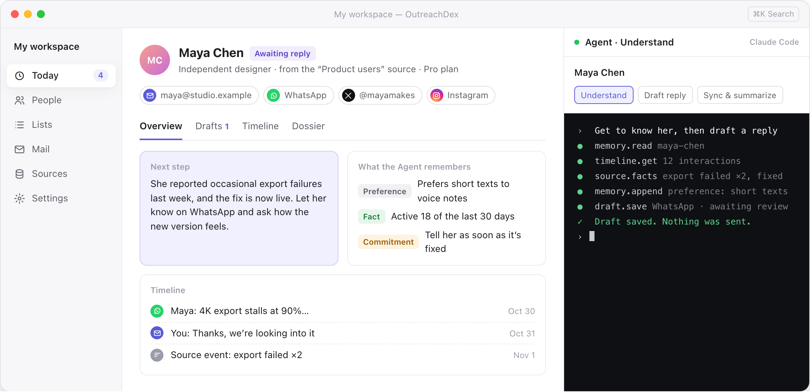
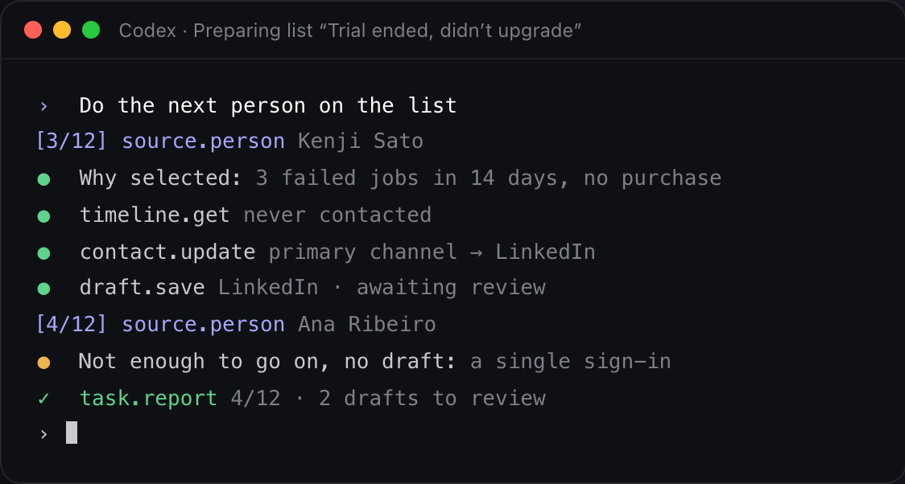

  

<h1 align="center">OutreachDex</h1>

  <b>連絡する前に、相手を知る。</b> 
  一対一のアウトリーチを、あなた自身の AI エージェントが準備します。

  <a href="README.md">English</a> · <a href="README.zh-CN.md">简体中文</a> · <b>日本語</b> · <a href="README.ko.md">한국어</a>

  <a href="https://github.com/OutreachDex/OutreachDex/releases">macOS 版をダウンロード</a> ·
  <a href="https://outreachdex.com">ウェブサイト</a> ·
  <a href="docs/help/ja/01-quick-start.md">ヘルプ</a>

  <picture>
    <source media="(prefers-color-scheme: dark)" srcset="docs/images/app-dark.png">
    
  </picture>
   
  画面はイメージです。登場する人物とデータはすべて架空のものです。

OutreachDex は、一対一のアウトリーチのためのデスクトップワークスペースです。受信トレイ、SNS、プロダクトのバックエンドに散らばった人々をひとつにまとめ、あなたの Claude Code または Codex が一人ひとりを理解したうえで、その人とチャネルに合ったメッセージを下書きします。

**メッセージは、送信前に必ずあなたが確認します。** OutreachDex はオープンソースでローカルファースト。クラウドアカウントもテレメトリもありません。

## 機能

- **今日**：返信を待っている人、確認が必要な下書き、フォローアップの時期が来た人が一目でわかります。アプリを開いた瞬間に、どこから始めればいいかがわかります。
- **覚えている人物メモ**：一人ひとりに Markdown の人物メモと、事実・好み・約束・未解決の質問を積み重ねる Agent メモリがあります。次の分析はゼロからではなく、そこから始まります。
- **コールドアウトリーチ用のリスト**：ソースの属性、イベント、連絡状況で絞り込み、今連絡する価値のある人を見つけます。Agent が一人ずつ調べて下書きし、あなたは 1 件ずつレビューします。
- **バックエンドとつなぐ**：読み取り専用のエンドポイントを 3 つ実装するだけで、ユーザー、プラン、利用状況、フィードバックを取り込めます。書く前に相手の状況を把握できます。
- **自分の Agent を使う**：すでにサインインしている Claude Code または Codex をそのまま使います。モデルとコストはあなたが選び、すべてのステップがターミナルに表示されます。
- **データはあなたのもの**：すべてのデータは、あなたが選んだワークスペースフォルダにプレーンなファイルとして保存されるので、そのまま Git で管理できます。

## チャネル

たいていの人には、いくつもの連絡手段があります。OutreachDex はすべてのチャネルを一人のプロフィールにまとめ、Agent はチャネルごとの作法に合わせて書きます。メールはじっくり、DM は短く、コメントへの返信は人間らしく。

| チャネル | OutreachDex がすること |
|---|---|
| メール | **送受信に対応。** IMAP で受信したメールを該当する人に自動で振り分け、承認した下書きは SMTP で同じスレッドに送信します。 |
| WhatsApp | そのまま WhatsApp に貼り付けられる、短く会話的な下書き。 |
| X | X に合った長さとトーンの DM と返信。 |
| TikTok | クリエイターとのやり取りのための DM とコメント返信。 |
| Facebook、Messenger、Instagram | DM。同じ人のアカウントはすべて一つのプロフィールにまとまります。 |
| LinkedIn | よりフォーマルなビジネスの連絡とフォローアップ。 |
| WeChat | WeChat を主に使う相手に。 |
| その他 | Telegram、Discord、フォーラム、通話メモなど、どんなチャネルでも履歴を記録できます。 |

メール以外では、OutreachDex があなたの SNS アカウントにサインインしたり、操作を自動化したりすることはありません。下書きを承認したら、それぞれのアプリに貼り付けて自分で送信し、戻ってきて **送信済みにする** をクリックして記録します。アカウントが自動化として検知されることはなく、相手にはボットではなくあなた自身から届きます。

## 使い方の流れ

1. **集める**：CSV やスプレッドシートを取り込み、受信トレイとバックエンドを接続します。複数のチャネルやシステムにまたがる同じ人は、一つの連絡先にまとまります。
2. **理解する**：Agent は、その人についてすでに知っていること、やり取りの履歴、ソースの事実から始め、背景、ニーズ、切り口をプロフィールに加えます。
3. **下書きする**：下書きはあなたの目的とチャネルに沿って書かれ、「なぜ今連絡するのか」から始まります。材料が足りないときは、水増しせずに何が足りないかを伝えます。
4. **レビューする**：複数のバージョンを並べて比較し、編集して承認します。承認済みの下書きを編集すると、再びレビューが必要になります。
5. **送信とフォローアップ**：メールはあなたが確認してから送信され、その他のチャネルはコピーして送信済みにします。返信は自動で整理され、フォローアップの時期が来るとお知らせします。

## Agent はすぐ隣で、見える形で働きます

  

アプリの右側には本物のターミナルがあり、あなた自身の Claude Code または Codex が動いています。Agent は OutreachDex の MCP ツールを通じて連絡先やドキュメントを読み書きします。いつでも割り込めますし、タスクを任せて別の人の対応に移ることもできます。

- 「この人」と言えば、Agent はあなたが見ている人を理解します。実行中のタスクは、あなたが別の人に切り替えても元の人のまま続きます。
- 結果は中央に表示されますが、キーボードを奪ったり、編集中の作業を中断したりはしません。
- Agent にできるのは下書きの保存だけです。**送信するためのツールは持っていません。**
- メールやウェブページの内容は証拠として扱われ、指示として実行されることはありません。

## バックエンドとつなぐ

ユーザーが今どんな状況にあるかは、あなたのバックエンドが一番よく知っています。GCSP/1 はオープンな読み取り専用プロトコルです。`GET /manifest`、`/people`、`/events` の 3 つを実装し、読み取り専用のトークンを発行するだけです。OutreachDex はカーソルで差分同期し、確認済みのメールアドレスと外部 ID で同じ人のレコードを結び付け、確信が持てないときはあなたに確認します。

- 呼び出すのは読み取り専用のエンドポイントだけで、バックエンドに書き込むことはありません。
- 保存するのは manifest で宣言された属性だけで、通信は HTTPS のみです。
- JSON Schema、Node と Go のリファレンス実装、CLI のセルフチェックが付属しています。

詳しくは [GCSP/1 仕様](docs/gcsp.md)（英語）をご覧ください。

## 節度を、最初から

- **勝手に送らない**：送信には必ずあなたの承認と、もう一度の確認が必要です。
- **一斉送信しない**：リストは一人ずつ準備し、一人ずつレビューします。「全員に送信」ボタンはありません。
- **しつこくしない**：「連絡しない」とした人はどのリストにも選ばれず、送信もできません。リストからのメッセージには 1 日の上限があります。
- **中身のない連絡をしない**：連絡するだけの理由がないとき、Agent は下書きを書かず、その理由を伝えます。

## こんな方に

- **個人開発者とプロダクトチーム**：つまずいているユーザー、離れそうなユーザー、問題を報告してくれたユーザーを見つけ、一人ずつフォローしながら本当のニーズを記録します。
- **研究者とクリエイター**：専門家、共同研究者、仲間に連絡し、それぞれの仕事と前回どこまで話したかを覚えておけます。
- **起業家、投資家、BD**：メール、LinkedIn、WhatsApp をまたいで関係を保ち、フォローアップを逃しません。
- **ブランドとクリエイターのタイアップ**：TikTok、Instagram、X で合うクリエイターを見つけ、相手が慣れた方法で会話を始めます。

## はじめかた

Mac と、インストールしてサインイン済みの [Claude Code](https://claude.com/claude-code) または [Codex](https://openai.com/codex/) が必要です。

1. [Releases](https://github.com/OutreachDex/OutreachDex/releases) からアプリをダウンロードします。
2. ワークスペースを作成します。テンプレートと空のフォルダを選びます。
3. 連絡先を追加するか、CSV やスプレッドシートからリストをインポートします。
4. **設定 → メールアカウント** でメールボックスを接続します（任意）。
5. 人物を開き、**Agent に聞く** をクリックします。

最初の使い方は [クイックスタート](docs/help/ja/01-quick-start.md) で順を追って説明しています。

## よくある質問

**無料ですか？**
はい。OutreachDex は無料のオープンソースです。分析と下書きには、すでにサインインしている Claude Code または Codex を使い、あなた自身のモデル利用枠を消費します。

**データはどこかにアップロードされますか？**
OutreachDex のクラウドはありません。連絡先、人物メモ、下書き、メールはあなたが選んだワークスペースフォルダに保存され、メールのパスワードとソースのトークンはローカルの鍵で暗号化されます。Agent が誰かを分析するときは、関連する内容が Claude Code または Codex の規約に従ってモデルの提供元に送られます。

**なぜ WhatsApp、TikTok、Meta では直接送信しないのですか？**
これらのプラットフォームは自動メッセージを制限しており、自動で送られた DM はなかなか誠実に受け取ってもらえません。OutreachDex は理解、下書き、記録を担当します。送信はそれぞれのアプリから自分で行い、「送信済みにする」をクリックすれば履歴は途切れません。

**対応しているプラットフォームは？**
現在は macOS のみです。他のプラットフォームにも対応予定です。

**メール一斉配信ツールとの違いは？**
一斉配信ツールが重視するのは量です。OutreachDex が重視するのは一通一通のメッセージです。まず相手を理解し、そのうえで連絡するかどうか、どのチャネルで、何を伝えるかを決めます。

そのほかの質問は [よくある質問](docs/help/ja/13-faq.md) をご覧ください。

## ドキュメント

- [ヘルプ](docs/help/ja/01-quick-start.md)
- [GCSP/1 仕様](docs/gcsp.md)：自社のバックエンドをデータソースとして接続する（英語）
- [開発ドキュメント](docs/development.md)：ビルド、テスト、リリース（英語）

## ライセンス

ライセンスはまだ決まっていません。
