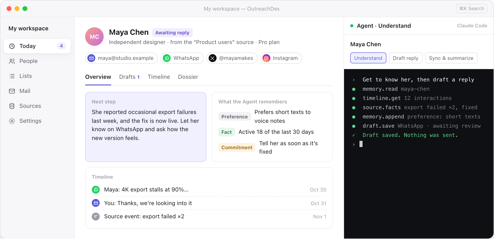
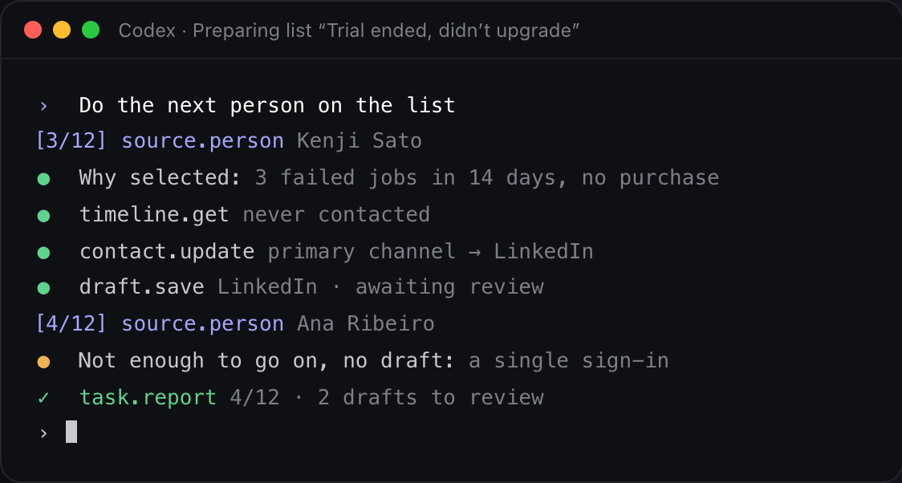

  

<h1 align="center">OutreachDex</h1>

  <b>연락하기 전에, 먼저 그 사람을 알아보세요.</b> 
  일대일 아웃리치를 당신의 AI 에이전트가 준비합니다.

  <a href="README.md">English</a> · <a href="README.zh-CN.md">简体中文</a> · <a href="README.ja.md">日本語</a> · <b>한국어</b>

  <a href="https://github.com/OutreachDex/OutreachDex/releases">macOS용 다운로드</a> ·
  <a href="https://outreachdex.com">웹사이트</a> ·
  <a href="docs/help/ko/01-quick-start.md">도움말</a>

  <picture>
    <source media="(prefers-color-scheme: dark)" srcset="docs/images/app-dark.png">
    
  </picture>
   
  예시 화면입니다. 등장하는 인물과 데이터는 모두 가상입니다.

OutreachDex는 일대일 아웃리치를 위한 데스크톱 워크스페이스입니다. 받은편지함, 소셜 앱, 제품 백엔드에 흩어져 있는 사람들을 한곳에 모으고, 당신의 Claude Code 또는 Codex가 한 사람 한 사람을 파악한 뒤 그 사람과 채널에 맞는 메시지 초안을 씁니다.

**모든 메시지는 보내기 전에 당신이 직접 검토합니다.** OutreachDex는 오픈 소스이자 로컬 우선 앱으로, 클라우드 계정도 텔레메트리도 없습니다.

## 기능

- **오늘**: 답장을 기다리는 사람, 검토할 초안, 후속 연락할 때가 된 사람을 한눈에 보여 줍니다. 앱을 여는 순간 어디서부터 시작할지 알 수 있습니다.
- **기억하는 인물 노트**: 사람마다 Markdown 인물 노트와, 사실·선호·약속·확인할 질문이 계속 쌓이는 Agent 메모리가 있습니다. 다음 분석은 처음부터가 아니라 여기서부터 시작합니다.
- **콜드 아웃리치용 리스트**: 소스 속성, 이벤트, 연락 상태로 걸러 지금 연락할 가치가 있는 사람을 찾습니다. Agent가 한 명씩 조사하고 초안을 쓰면, 당신은 하나씩 검토합니다.
- **백엔드 연결**: 읽기 전용 엔드포인트 3개만 구현하면 사용자, 요금제, 사용량, 피드백을 가져올 수 있어, 글을 쓰기 전에 상대의 상황을 이해할 수 있습니다.
- **내 Agent 그대로 사용**: 이미 로그인해 둔 Claude Code나 Codex를 그대로 실행합니다. 모델과 비용은 당신이 정하고, 모든 단계가 터미널에 표시됩니다.
- **데이터는 당신의 것**: 모든 데이터는 당신이 고른 워크스페이스 폴더에 일반 파일로 저장되므로 그대로 Git에 넣어 관리할 수 있습니다.

## 채널

대부분의 사람은 여러 곳에서 연락이 닿습니다. OutreachDex는 모든 채널을 한 사람의 프로필에 모아 두고, Agent는 채널마다의 관례에 맞춰 씁니다. 이메일은 여유 있게, DM은 짧게, 댓글 답글은 사람처럼.

| 채널 | OutreachDex가 하는 일 |
|---|---|
| 이메일 | **보내기와 받기.** IMAP으로 받은 메일을 해당하는 사람에게 자동으로 연결하고, 승인한 초안은 SMTP로 같은 스레드에 보냅니다. |
| WhatsApp | WhatsApp에 바로 붙여 넣을 수 있는 짧고 대화체인 초안. |
| X | X에 맞는 길이와 어조의 DM과 답글. |
| TikTok | 크리에이터와 협업하기 위한 DM과 댓글 답글. |
| Facebook, Messenger, Instagram | DM. 한 사람의 모든 계정이 하나의 프로필에 모입니다. |
| LinkedIn | 좀 더 격식 있는 비즈니스 연락과 후속 연락. |
| WeChat | 주로 WeChat을 쓰는 연락처를 위해. |
| 그 밖의 채널 | Telegram, Discord, 포럼, 통화 메모 등 어떤 채널이든 기록과 이력을 남길 수 있습니다. |

이메일을 제외하면 OutreachDex는 당신의 소셜 계정에 로그인하거나 작업을 자동화하지 않습니다. 초안을 승인하면 해당 앱에 붙여 넣어 직접 보내고, 돌아와서 **보냄으로 표시**를 눌러 기록합니다. 계정이 자동화로 의심받을 일이 없고, 상대는 봇이 아닌 당신에게서 메시지를 받습니다.

## 작동 방식

1. **모으기**: CSV나 스프레드시트를 가져오고 받은편지함과 백엔드를 연결합니다. 여러 채널과 시스템에 흩어진 같은 사람은 하나의 연락처로 합쳐집니다.
2. **파악하기**: Agent는 그 사람에 대해 이미 아는 것, 주고받은 기록, 소스의 사실에서 출발해 배경, 필요, 접근할 포인트를 프로필에 더합니다.
3. **초안 쓰기**: 초안은 당신의 목표와 채널에 맞춰 쓰이고, 왜 지금 연락하는지로 시작합니다. 정보가 부족하면 억지로 채우지 않고 무엇이 부족한지 알려 줍니다.
4. **검토하기**: 여러 버전을 나란히 비교하고, 수정한 뒤 승인합니다. 승인된 초안을 수정하면 다시 검토해야 합니다.
5. **보내고 후속 연락하기**: 이메일은 당신이 확인하면 발송되고, 다른 채널은 복사한 뒤 보냄으로 표시합니다. 답장은 자동으로 정리되고, 후속 연락할 때가 되면 알려 줍니다.

## Agent는 바로 옆에서, 보이는 곳에서 일합니다

  

앱 오른쪽에는 진짜 터미널이 있고, 당신의 Claude Code 또는 Codex가 실행됩니다. Agent는 OutreachDex의 MCP 도구로 연락처와 문서를 읽고 씁니다. 언제든 끼어들 수 있고, 작업을 맡겨 두고 다른 사람에게 넘어갈 수도 있습니다.

- "이 사람"이라고 말하면 Agent는 당신이 보고 있는 사람을 압니다. 이미 실행 중인 작업은 다른 사람으로 전환해도 원래 사람을 그대로 유지합니다.
- 결과는 가운데에 열리지만, 키보드를 빼앗거나 편집 중인 작업을 방해하지 않습니다.
- Agent는 초안을 저장하는 것만 할 수 있습니다. **보내기 도구는 없습니다.**
- 이메일과 웹 페이지 내용은 근거로만 다루며, 지시로 실행하지 않습니다.

## 백엔드 연결

사용자가 지금 어떤 상황인지는 당신의 백엔드가 가장 잘 압니다. GCSP/1은 공개된 읽기 전용 프로토콜입니다. `GET /manifest`, `/people`, `/events` 세 개를 구현하고 읽기 전용 토큰을 발급하면 됩니다. OutreachDex는 커서로 증분 동기화하고, 인증된 이메일과 외부 ID로 같은 사람의 기록을 연결하며, 확실하지 않을 때는 당신에게 묻습니다.

- 읽기 전용 엔드포인트만 호출하며 백엔드에 아무것도 쓰지 않습니다.
- manifest에 선언된 속성만 저장하며, HTTPS로만 통신합니다.
- JSON Schema, Node와 Go 레퍼런스 구현, CLI 자체 점검 도구가 함께 제공됩니다.

자세한 내용은 [GCSP/1 사양](docs/gcsp.md)(영어)을 참고하세요.

## 절제가 기본입니다

- **스스로 보내지 않습니다**: 모든 발송에는 당신의 승인과 한 번의 추가 확인이 필요합니다.
- **대량 발송은 없습니다**: 리스트는 한 명씩 준비하고 한 명씩 검토합니다. "모두에게 보내기" 버튼은 없습니다.
- **귀찮게 하지 않습니다**: "연락 안 함"으로 표시한 사람은 어떤 리스트에도 선택되지 않고, 보낼 수도 없습니다. 리스트 메시지에는 하루 한도가 있습니다.
- **빈말은 쓰지 않습니다**: 연락할 만한 이유가 없으면 Agent는 초안을 쓰지 않고 그 이유를 알려 줍니다.

## 이런 분께 추천합니다

- **인디 개발자와 제품 팀**: 막혀 있거나, 이탈하려 하거나, 문제를 알려 준 사용자를 찾아 한 명씩 후속 연락하고, 그들이 정말 필요로 하는 것을 기록합니다.
- **연구자와 크리에이터**: 전문가, 협업자, 동료에게 연락하고, 각자의 작업과 지난번 대화가 어디까지였는지 기억합니다.
- **창업자, 투자자, BD**: 이메일, LinkedIn, WhatsApp을 넘나들며 관계를 이어 가고 후속 연락을 놓치지 않습니다.
- **브랜드와 크리에이터 협업**: TikTok, Instagram, X에서 맞는 크리에이터를 찾고, 그들에게 익숙한 방식으로 대화를 시작합니다.

## 시작하기

Mac과, 설치 후 로그인한 [Claude Code](https://claude.com/claude-code) 또는 [Codex](https://openai.com/codex/)가 필요합니다.

1. [Releases](https://github.com/OutreachDex/OutreachDex/releases)에서 앱을 내려받습니다.
2. 워크스페이스를 만듭니다. 템플릿과 빈 폴더를 고릅니다.
3. 연락처를 추가하거나 CSV, 스프레드시트에서 리스트를 가져옵니다.
4. **설정 → 메일 계정**에서 메일함을 연결합니다(선택).
5. 사람을 열고 **Agent에게 묻기**를 누릅니다.

처음 사용하는 과정은 [빠른 시작](docs/help/ko/01-quick-start.md)에서 차근차근 안내합니다.

## 자주 묻는 질문

**무료인가요?**
네. OutreachDex는 무료 오픈 소스입니다. 분석과 초안 작성은 이미 로그인해 둔 Claude Code 또는 Codex로 실행되며, 당신의 모델 사용량을 씁니다.

**내 데이터가 어딘가에 업로드되나요?**
OutreachDex 클라우드는 없습니다. 연락처, 인물 노트, 초안, 메일은 당신이 고른 워크스페이스 폴더에 저장되고, 메일 비밀번호와 소스 토큰은 로컬 키로 암호화됩니다. Agent가 누군가를 분석할 때는 관련 내용이 Claude Code 또는 Codex의 약관에 따라 모델 제공업체로 전송됩니다.

**왜 WhatsApp, TikTok, Meta에서는 바로 보내지 않나요?**
이 플랫폼들은 자동 메시지를 제한하고, 자동으로 보낸 DM은 진심으로 받아들여지기 어렵습니다. OutreachDex는 파악하고, 초안을 쓰고, 기억하는 일을 맡습니다. 발송은 해당 앱에서 직접 하고 "보냄으로 표시"를 누르면 기록이 끊기지 않습니다.

**어떤 플랫폼에서 실행되나요?**
현재는 macOS만 지원합니다. 다른 플랫폼도 지원할 계획입니다.

**이메일 대량 발송 도구와 무엇이 다른가요?**
대량 발송 도구는 양을 최적화합니다. OutreachDex는 메시지 하나하나를 최적화합니다. 먼저 그 사람을 이해한 다음, 연락할지, 어떤 채널로, 무엇을 말할지 정합니다.

더 많은 답은 [자주 묻는 질문](docs/help/ko/13-faq.md)에서 확인하세요.

## 문서

- [도움말](docs/help/ko/01-quick-start.md)
- [GCSP/1 사양](docs/gcsp.md): 자체 백엔드를 데이터 소스로 연결하기(영어)
- [개발 문서](docs/development.md): 빌드, 테스트, 릴리스(영어)

## 라이선스

라이선스는 아직 정해지지 않았습니다.
