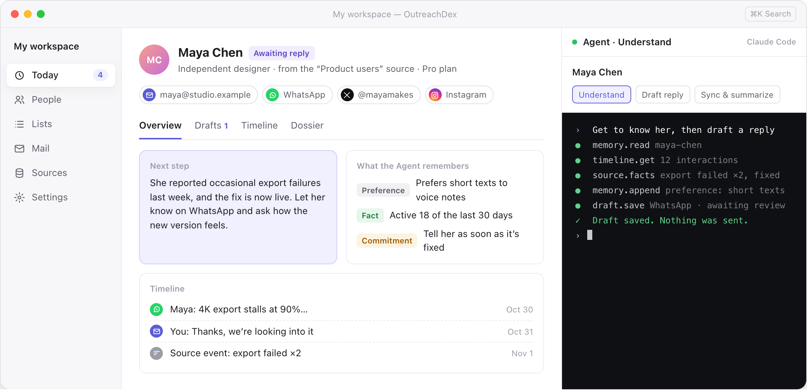
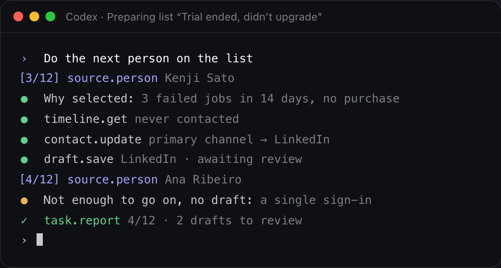

  

<h1 align="center">OutreachDex</h1>

  <b>Know them before you reach out.</b> 
  One-to-one outreach, prepared by your own AI agent.

  <b>English</b> · <a href="README.zh-CN.md">简体中文</a> · <a href="README.ja.md">日本語</a> · <a href="README.ko.md">한국어</a>

  <a href="https://github.com/OutreachDex/OutreachDex/releases">Download for macOS</a> ·
  <a href="https://outreachdex.com">Website</a> ·
  <a href="https://outreachdex.com/help/">Help Center</a>

  <picture>
    <source media="(prefers-color-scheme: dark)" srcset="docs/images/app-dark.png">
    
  </picture>
   
  Illustrative UI. All people and data are fictional.

OutreachDex is a desktop workspace for one-to-one outreach. It brings together the people scattered across your inbox, social apps and product backend. Your own Claude Code or Codex gets to know each of them, then drafts a message that fits the person and the channel.

**You review every message before it goes out.** OutreachDex is open source and local-first, with no cloud account and no telemetry.

## Features

- **Today.** See who's waiting on you, which drafts need review and who's due a follow-up, so you know where to start the moment you open the app.
- **Profiles that remember.** Every person gets a Markdown profile and a running memory of facts, preferences, commitments and open questions. The next analysis starts there instead of from zero.
- **Lists for cold outreach.** Filter by source attributes, events and contact status to find who's worth reaching right now. The Agent researches and drafts each person in turn, and you review them one at a time.
- **Connect your backend.** Implement three read-only endpoints to bring in users, plans, usage and feedback, so you understand someone's situation before you write.
- **Bring your own Agent.** OutreachDex runs the Claude Code or Codex you're already signed in to. You choose the model and the spend, and every step shows up in the terminal.
- **Your data stays yours.** Everything is stored as plain files in a workspace folder you choose, so you can keep it in Git.

## Channels

Most people can be reached in several places. OutreachDex keeps every channel on one profile, and the Agent writes for each channel's norms: an email can take its time, a DM should be short, a comment reply should sound human.

| Channel | What OutreachDex does |
|---|---|
| Email | **Send & receive.** Incoming mail is matched to the right person over IMAP. Approved drafts go out over SMTP and stay in the same thread. |
| WhatsApp | Short, conversational drafts you copy straight into WhatsApp. |
| X | DMs and replies, with the length and tone X expects. |
| TikTok | DMs and comment replies for working with creators. |
| Facebook, Messenger, Instagram | DMs, with all of a person's accounts on one profile. |
| LinkedIn | More formal business outreach and follow-ups. |
| WeChat | For contacts who live on WeChat. |
| Anything else | Telegram, Discord, forums, call notes: log any channel and its history. |

Except for email, OutreachDex never signs in to or automates your social accounts. After you approve a draft, you copy it into the app, send it yourself, then click **Mark as sent** to log it. Your accounts are never flagged for automation, and people hear from you rather than a bot.

## How it works

1. **Collect.** Import a CSV or spreadsheet, then connect your inbox and backends. The same person across many channels and systems becomes a single contact.
2. **Understand.** The Agent starts with what it already knows about the person, their history and the facts from your sources, then adds background, needs and an angle to their profile.
3. **Draft.** Each draft follows your goal and the channel, and opens with why you're reaching out now. When there isn't enough to go on, the Agent tells you what's missing instead of padding.
4. **Review.** Compare versions side by side, edit and approve. Editing an approved draft sends it back for review.
5. **Send and follow up.** Email goes out once you confirm; other channels are copied and marked as sent. Replies are filed automatically, and you're reminded when a follow-up is due.

## Your Agent works beside you, in plain sight

  

A real terminal sits on the right of the app, running your own Claude Code or Codex. It reads and writes contacts and documents through OutreachDex's MCP tools. Jump in at any point, or hand off a task and move on to someone else.

- Say "this person" and the Agent knows who you're looking at. A task that's already running keeps its original person when you switch.
- Results open in the center for you to see, without taking your keyboard or interrupting whatever you're editing.
- The Agent can only save drafts. **It has no tool for sending.**
- Email and web content is treated as evidence, never as instructions.

## Connect your backend

Your backend knows what your users are going through. GCSP/1 is an open, read-only protocol: implement `GET /manifest`, `/people` and `/events`, and issue a read-only token. OutreachDex syncs incrementally, links records to the same person by verified email and external identity, and asks you whenever it isn't sure.

- It calls read-only endpoints only and never writes to your backend.
- It stores only the attributes your manifest declares, over HTTPS only.
- The spec comes with a JSON Schema, Node and Go reference implementations, and a CLI self-check.

Read the [GCSP/1 spec](docs/gcsp.md).

## Restraint, built in

- **Never sends on its own.** Every send needs your approval, then one more confirmation.
- **No blasts.** Lists are prepared and reviewed one person at a time. There's no send-to-all button.
- **No pestering.** No list can select or send to anyone marked Do not contact, and list messages have a daily cap.
- **No filler.** When there's no good reason to reach out, the Agent doesn't write a draft, and says why.

## Who it's for

- **Indie developers and product teams.** Find the users who are stuck, churning or reported a problem, follow up with each of them, and capture what they actually need.
- **Researchers and creators.** Reach out to experts, collaborators and peers, and remember each person's work and where you left off.
- **Founders, investors and BD.** Keep relationships warm across email, LinkedIn and WhatsApp without missing a follow-up.
- **Brand and creator partnerships.** Find the right creators on TikTok, Instagram and X, and start the conversation the way they're used to.

## Get started

You need a Mac and [Claude Code](https://claude.com/claude-code) or [Codex](https://openai.com/codex/) installed and signed in.

1. Download the app from [Releases](https://github.com/OutreachDex/OutreachDex/releases).
2. Create a workspace: pick a template and an empty folder.
3. Add contacts, or import a list from CSV or a spreadsheet.
4. Connect your mailbox in **Settings → Mail accounts** (optional).
5. Open a person and click **Ask Agent**.

The [quick start](https://outreachdex.com/help/quick-start/) walks through the first session.

## FAQ

**Is it free?**
Yes. OutreachDex is free and open source. Analysis and drafting run on the Claude Code or Codex you're already signed in to, using your own model quota.

**Is my data uploaded anywhere?**
There's no OutreachDex cloud. Contacts, profiles, drafts and mail live in the workspace folder you choose, and mailbox passwords and source tokens are encrypted with a local key. When the Agent analyzes someone, the relevant content is sent to your model provider under the terms of Claude Code or Codex.

**Why doesn't it send directly on WhatsApp, TikTok or Meta?**
Those platforms restrict automated messaging, and automated DMs rarely come across as genuine. OutreachDex handles the understanding, drafting and remembering. You send from the app itself and click Mark as sent, so the history stays complete.

**Which platforms does it run on?**
macOS for now. Other platforms are on the roadmap.

**How is this different from email blast tools?**
Blast tools optimize for volume. OutreachDex optimizes each message: understand the person first, then decide whether to reach out, on which channel, and what to say.

More answers in the [Help Center](https://outreachdex.com/help/troubleshooting/).

## Documentation

- [Help Center](https://outreachdex.com/help/): the user guide
- [GCSP/1 spec](docs/gcsp.md): connect your own backend as a data source
- [Development](docs/development.md): building, testing and releasing

## License

The license has not been chosen yet.
