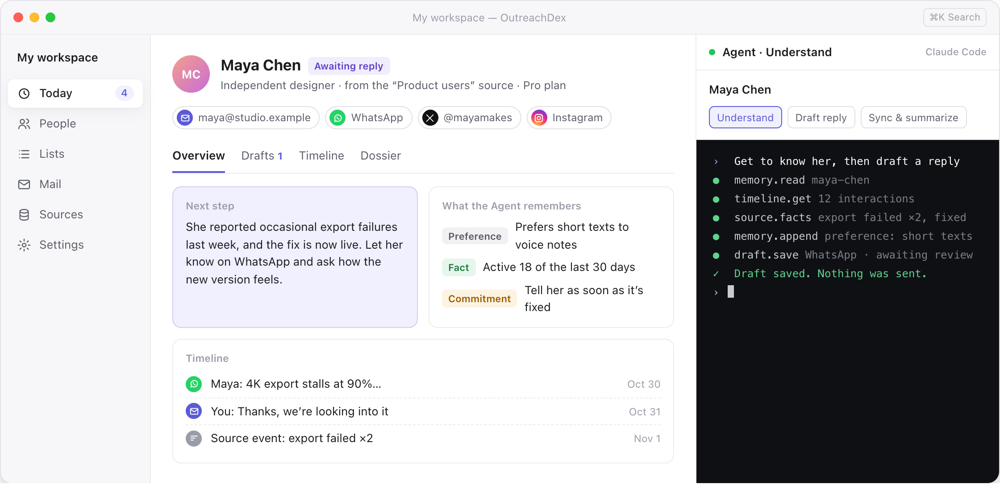
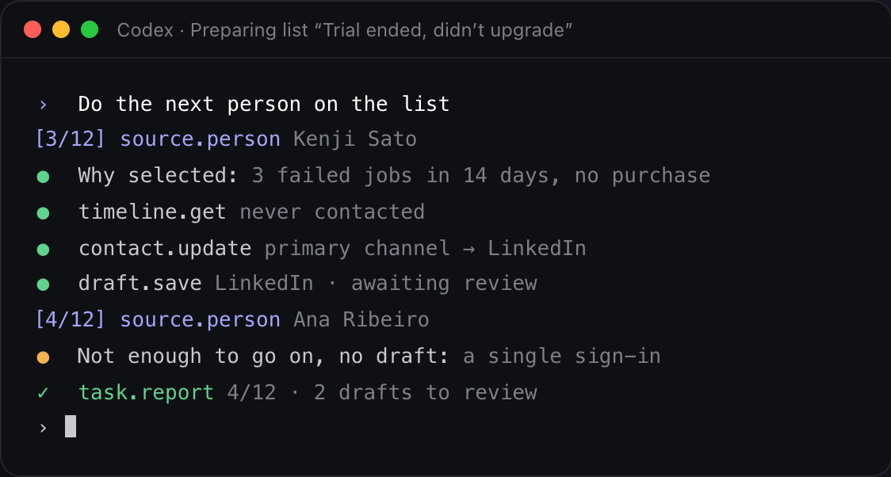

  

<h1 align="center">OutreachDex</h1>

  <b>先了解对方，再开口联系。</b> 
  一对一触达，由你自己的 AI Agent 来准备。

  <a href="README.md">English</a> · <b>简体中文</b> · <a href="README.ja.md">日本語</a> · <a href="README.ko.md">한국어</a>

  <a href="https://github.com/OutreachDex/OutreachDex/releases">下载 macOS 版</a> ·
  <a href="https://outreachdex.com">官网</a> ·
  <a href="docs/help/zh/01-quick-start.md">使用帮助</a>

  <picture>
    <source media="(prefers-color-scheme: dark)" srcset="docs/images/app-dark.png">
    
  </picture>
   
  界面示意图，其中的人物和数据均为虚构。

OutreachDex 是一款做一对一触达的桌面工作台。它把散落在邮箱、社交应用和产品后台里的人汇总到一起，让你自己的 Claude Code 或 Codex 逐个了解他们，再按这个人和所用的渠道起草一条合适的消息。

**每条消息发出前都由你审核。** OutreachDex 开源、本地优先，没有云端账号，也不收集任何使用数据。

## 功能

- **今日**：谁在等你回复、哪些草稿要审、谁该跟进了，打开应用就知道从哪开始。
- **会记事的档案**：每个人都有一份 Markdown 档案，以及一份持续追加的 Agent 记录，写着事实、偏好、承诺和待确认的问题。下一次分析从这里接着来，不用从零开始。
- **陌生触达名单**：按来源属性、事件和联系状态筛选，找出现在值得联系的人。Agent 逐个调研、逐个起草，你一条一条地审。
- **接入你的后台**：实现三个只读接口，就能把用户、套餐、用量和反馈带进来，动笔之前先弄清对方的处境。
- **用你自己的 Agent**：直接运行你已登录的 Claude Code 或 Codex。模型和花费由你决定，每一步都显示在终端里。
- **数据归你所有**：所有内容都以普通文件的形式存在你选的工作区文件夹里，可以直接放进 Git。

## 渠道

大多数人都能在好几个地方联系到。OutreachDex 把一个人的所有渠道放在同一份档案里，Agent 会按每个渠道的习惯来写：邮件可以从容一些，私信要短，评论回复要像真人说话。

| 渠道 | OutreachDex 做什么 |
|---|---|
| 邮件 | **收发都在应用里。** 通过 IMAP 收信并自动归到对应的人，批准后的草稿通过 SMTP 发出，留在同一个邮件线程里。 |
| WhatsApp | 简短、口语化的草稿，直接复制到 WhatsApp。 |
| X | 私信和回复，长度和语气都按 X 的习惯来。 |
| TikTok | 私信和评论回复，适合与创作者合作。 |
| Facebook、Messenger、Instagram | 私信。同一个人的所有账号都在一份档案里。 |
| LinkedIn | 更正式的商务联系和跟进。 |
| 微信 | 给主要用微信联系的人。 |
| 其他 | Telegram、Discord、论坛、通话记录：任何渠道及其历史都可以记下来。 |

除了邮件，OutreachDex 不会登录或自动操作你的任何社交账号。草稿批准后，你把它复制到对应的应用里亲自发送，再回来点 **标记已发** 记一笔。这样你的账号不会被判成自动化操作，对方收到的也是你本人的消息，而不是机器人。

## 工作流程

1. **汇总**：导入 CSV 或表格，再接入邮箱和后台。同一个人在多个渠道、多个系统里的记录会合并成一个联系人。
2. **了解**：Agent 先读它已经知道的、往来历史和来源里的事实，再把背景、需求和切入点补进档案。
3. **起草**：每份草稿都按你的目标和渠道来写，开头先说为什么现在联系。信息不够时，Agent 会告诉你缺什么，而不是硬凑。
4. **审核**：多个版本并排对比，修改后批准。改动已批准的草稿，需要重新审核。
5. **发送与跟进**：邮件在你确认后发出；其他渠道复制后标记已发。回复会自动归档，该跟进时会提醒你。

## Agent 就在你旁边，每一步都看得见

  

应用右侧是一个真正的终端，运行的是你自己的 Claude Code 或 Codex。它通过 OutreachDex 的 MCP 工具读写联系人和文档。你可以随时插话，也可以把任务交给它，转头去处理别人。

- 说“这个人”，Agent 就知道你在看谁。已经在跑的任务不会因为你切换联系人而换人。
- 结果会在中间打开给你看，但不会抢走键盘，也不会打断你正在编辑的内容。
- Agent 只能保存草稿，**它没有任何发送工具。**
- 邮件和网页内容只被当作证据，绝不会被当作指令执行。

## 接入你的后台

你的后台最清楚用户正在经历什么。GCSP/1 是一个开放的只读协议：实现 `GET /manifest`、`/people` 和 `/events` 三个接口，再签发一个只读 token。OutreachDex 按游标增量同步，根据已验证的邮箱和外部身份把记录关联到同一个人，拿不准的时候会问你。

- 只调用只读接口，从不往你的后台写数据。
- 只保存 manifest 里声明的属性，且只走 HTTPS。
- 协议附带 JSON Schema、Node 和 Go 参考实现，以及命令行自检工具。

详见 [GCSP/1 规范](docs/gcsp.md)（英文）。

## 克制，是内置的

- **从不自己发送**：每次发送都要你先批准，再确认一次。
- **不群发**：名单里的人逐个准备、逐个审核，没有“全部发送”按钮。
- **不打扰**：标记为“不再联系”的人不会被任何名单选中，也发不出去；名单消息每天有上限。
- **不凑数**：没有充分的理由联系时，Agent 不写草稿，并说明原因。

## 适合谁

- **独立开发者和产品团队**：找出卡住了、快流失了或者反馈过问题的用户，逐个跟进，并记下他们真正需要什么。
- **研究者和创作者**：联系专家、合作者和同行，记住每个人做过什么、上次聊到哪。
- **创始人、投资人和 BD**：在邮件、LinkedIn 和 WhatsApp 之间维系关系，不漏掉任何一次跟进。
- **品牌与创作者合作**：在 TikTok、Instagram 和 X 上找到合适的创作者，用他们习惯的方式开启对话。

## 开始使用

你需要一台 Mac，并且已经安装和登录 [Claude Code](https://claude.com/claude-code) 或 [Codex](https://openai.com/codex/)。

1. 从 [Releases](https://github.com/OutreachDex/OutreachDex/releases) 下载应用。
2. 新建工作区：选一个模板和一个空文件夹。
3. 添加联系人，或者从 CSV、表格导入名单。
4. 在 **设置 → 邮箱连接** 里接入邮箱（可选）。
5. 打开一个人，点 **让 Agent 了解**。

[快速开始](docs/help/zh/01-quick-start.md) 会带你走完第一次使用的流程。

## 常见问题

**免费吗？**
免费，而且开源。分析和起草用的是你已登录的 Claude Code 或 Codex，消耗你自己的模型额度。

**我的数据会被上传吗？**
OutreachDex 没有云端。联系人、档案、草稿和邮件都存在你选的工作区文件夹里，邮箱密码和数据源 token 用本机密钥加密。Agent 分析某个人时，相关内容会按 Claude Code 或 Codex 的服务条款发送给你的模型服务商。

**为什么不直接在 WhatsApp、TikTok 或 Meta 上发送？**
这些平台限制自动发消息，自动发出的私信也很难显得真诚。OutreachDex 负责了解、起草和记录；你在对应的应用里亲自发送，再点“标记已发”，往来历史依然完整。

**支持哪些系统？**
目前只支持 macOS，其他平台在计划中。

**和邮件群发工具有什么不同？**
群发工具追求数量。OutreachDex 追求每一条消息本身：先了解这个人，再决定要不要联系、用哪个渠道、说什么。

更多问题见 [常见问题](docs/help/zh/13-faq.md)。

## 文档

- [使用帮助](docs/help/zh/01-quick-start.md)
- [GCSP/1 规范](docs/gcsp.md)：把你自己的后台接入为数据源（英文）
- [开发文档](docs/development.md)：构建、测试和发布（英文）

## 许可证

许可证尚未确定。
